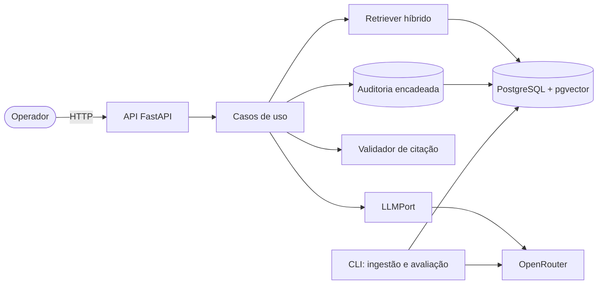

# Grid Contingency Copilot

**Summary.** A copilot that suggests response steps for synthetic power-grid contingency events (e.g. a transmission line tripped by protection), citing the exact fictional operating procedure each step comes from. Citations are verified by code, not trusted from the model. When no applicable procedure exists, the system refuses explicitly. Every suggestion needs human approval, and everything is recorded in a hash-chained audit trail. Quality is measured with a scenario-based evaluation suite (2 models, with and without RAG). All data is synthetic; this is a portfolio project inspired by public challenges in the power sector, and it is not suitable for real operations.

---

> **Aviso.** Todos os procedimentos, eventos e valores são fictícios e foram escritos para este projeto. O sistema não deve ser usado em operação real.

## Problema

Em uma contingência, o operador precisa de passos de resposta rápidos e rastreáveis ao procedimento aprovado. Um LLM sem controle pode inventar passos plausíveis, e uma sugestão sem fonte não tem valor operacional.

## Solução

1. O operador registra um evento de rede.
2. O sistema recupera trechos de procedimentos relevantes (busca híbrida: vetorial + full-text).
3. Um LLM propõe passos, cada um com `chunk_id` e trecho literal citado.
4. O código verifica que cada trecho existe literalmente no procedimento recuperado. Passos sem citação válida são descartados.
5. Se não há procedimento aplicável, ou nenhum passo sobrevive à verificação, o sistema recusa e informa o motivo.
6. O operador aprova ou rejeita (rejeição exige justificativa). Nada é "aprovado" sem decisão humana.
7. Cada etapa fica em uma trilha de auditoria só de acréscimo, com encadeamento por hash.

A garantia é "toda citação existe e foi recuperada", não "toda sugestão está correta". Ver `docs/06-riscos-e-limitacoes.md`.

## Arquitetura



Detalhes em `docs/01-arquitetura.md` e nos ADRs em `docs/adr/`.

## Como rodar

Pré-requisitos: Docker, Docker Compose e uma chave do OpenRouter (apenas para uso com modelos reais).

```bash
git clone <url-do-repositorio>
cd grid-contingency-copilot
cp .env.example .env          # preencher OPENROUTER_API_KEY
docker compose up -d          # API em http://localhost:8000 e Swagger em /docs
make ingest                   # indexa knowledge_base/ no banco
make test                     # testes unitários e de integração
make eval-fake                # avaliação determinística (sem custo)
make eval                     # avaliação com modelos reais (usa créditos)
make audit-verify             # verifica a cadeia de hashes da auditoria
```

Os comandos acima são o contrato do projeto; as alvos do `Makefile` são implementadas conforme o roadmap (`docs/05-roadmap.md`).

## Resultados da avaliação

Placeholder: preencher após a primeira rodada completa. N = número de cenários; intervalos de confiança por bootstrap.

| Configuração | Recall@6 | Citação válida | Recusa correta (P / R) | Alucinação | N |
|---|---|---|---|---|---|
| Modelo A, com RAG | | | | | |
| Modelo B, com RAG | | | | | |
| Modelo A, sem RAG | | | | | |
| Modelo B, sem RAG | | | | | |
| Baseline lexical + Modelo A | | | | | |

Os resultados comparam configurações no mesmo conjunto de cenários, escrito pela autora; não indicam generalização. Protocolo em `docs/03-avaliacao.md`.

## Limitações

- Dados e procedimentos sintéticos; o realismo é limitado.
- Verificação de citação é literal: não garante que o passo decorre do trecho.
- Operador identificado por texto, sem autenticação.
- "Imutável" significa acréscimo apenas via aplicação e adulteração detectável; não protege contra administrador do banco.
- Conjunto de avaliação pequeno e de autor único.
- Não integra com nenhum sistema real e não executa ações.

## Próximos passos

- Revisão externa dos cenários de avaliação.
- Ancoragem do hash final da auditoria em um sistema externo.
- Modo de reformulação iterativa da busca e comparação com orquestração em grafo.
- Juiz de fidelidade semântica calibrado.
- Autenticação e papéis.

## Documentação

`docs/00-escopo.md`, `docs/01-arquitetura.md`, `docs/02-api.md`, `docs/03-avaliacao.md`, `docs/04-base-de-conhecimento.md`, `docs/05-roadmap.md`, `docs/06-riscos-e-limitacoes.md`, `docs/adr/`.

## Licença

MIT para o código. Procedimentos fictícios sob CC0.
