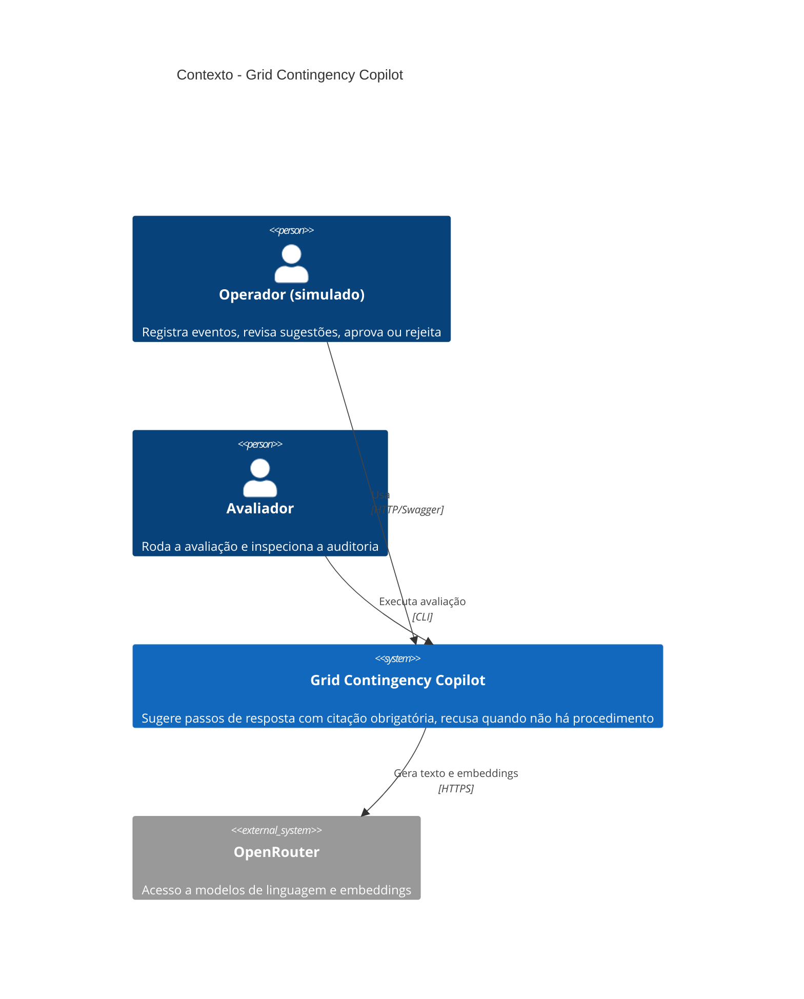
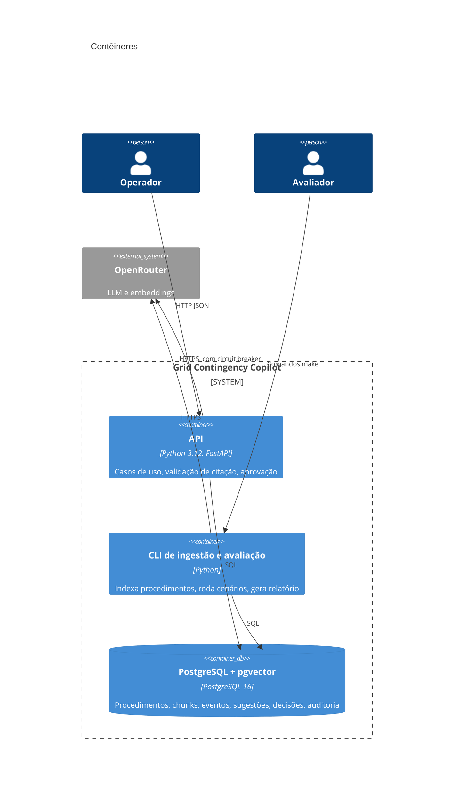
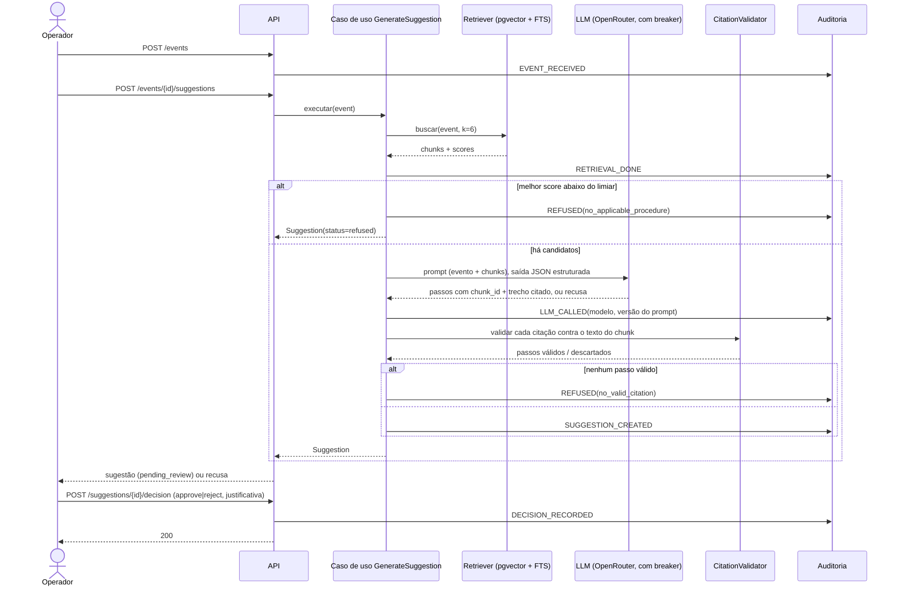
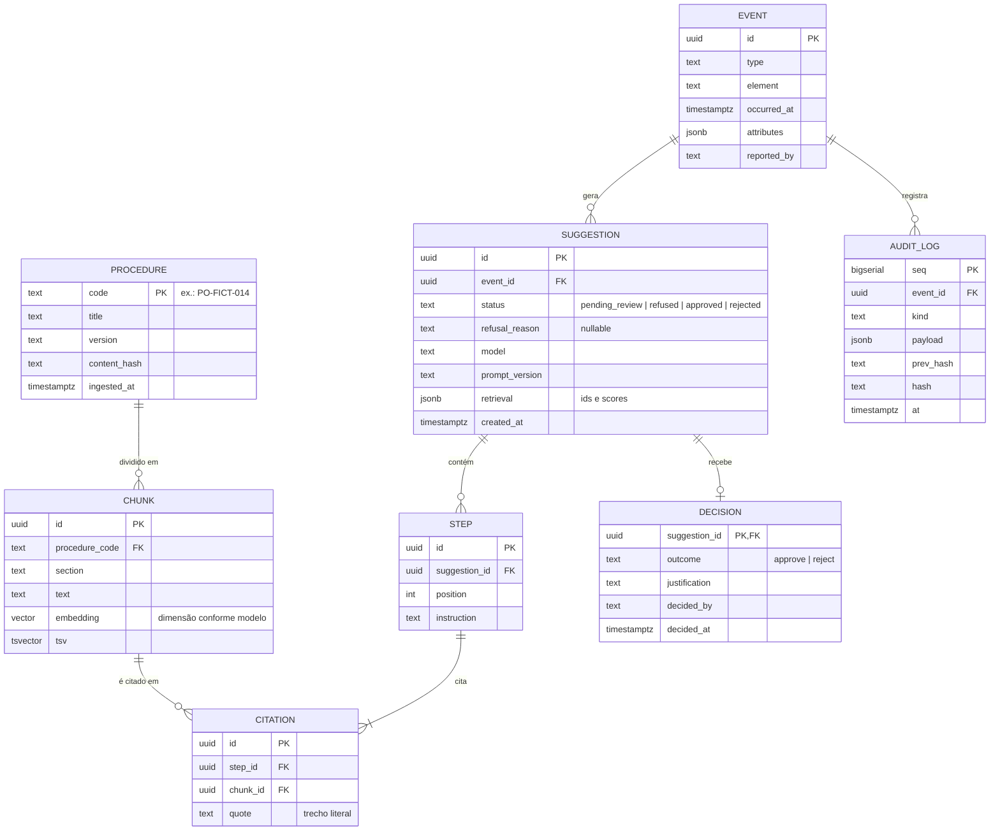

# 01 - Arquitetura

## Contexto (C4 nível 1)



## Contêineres (C4 nível 2)



Não há Redis nem fila no desenho mínimo. A geração é síncrona, porque uma sugestão leva segundos e o volume é de um operador.

## Fluxo principal



## Estrutura de pastas (hexagonal)

```text
grid-contingency-copilot/
  src/copilot/
    domain/                  # sem I/O, sem frameworks
      models.py              # Event, Procedure, Chunk, Suggestion, Step, Citation, Decision
      rules.py               # estados válidos, regra "sem decisão humana não há aprovação"
      citation.py            # normalização e checagem literal do trecho
    application/
      ports.py               # Protocols: LLMPort, EmbedderPort, RetrieverPort, *Repository, AuditLog, Clock
      use_cases/
        register_event.py
        generate_suggestion.py
        record_decision.py
        get_audit_trail.py
      prompts/               # prompts versionados (v1.md, v2.md)
    adapters/
      inbound/
        http/                # FastAPI: routers, schemas, mapeamento de erros
        cli/                 # ingest, eval
      outbound/
        postgres/            # repositórios, retriever híbrido, auditoria encadeada
        llm/                 # OpenRouter client, circuit breaker, fallback
        fakes/               # FakeLLM, FakeEmbedder, repositórios em memória
    config.py                # settings por variável de ambiente
    main.py                  # composição (wiring)
  knowledge_base/            # procedimentos fictícios em Markdown
  eval/
    scenarios/*.yaml
    run_eval.py
    reports/
  migrations/                # SQL versionado (Alembic ou arquivos numerados)
  tests/
    unit/                    # domain + application com fakes
    integration/             # Postgres real (testcontainers ou service da CI)
  docs/
  docker-compose.yml
  Makefile
```

Regra de dependência: `domain` não importa nada de fora; `application` importa só `domain`; `adapters` importam as duas e implementam as portas; `main.py` é o único lugar que conhece as implementações concretas.

## Modelo de dados



Observações:

- `SUGGESTION.status` só chega a `approved` ou `rejected` via `DECISION`. Um `CHECK` e o caso de uso garantem isso.
- `AUDIT_LOG` recebe apenas `INSERT`. Os detalhes estão no ADR-006.
- `PROCEDURE.version` e `content_hash` permitem saber, na auditoria, qual texto exato foi citado.
